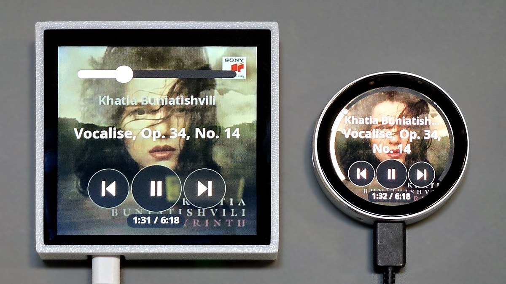

# Home Assistant Media Remote

A touch remote for one Home Assistant `media_player`, on an ESP32-S3 with a
small display. It shows what is playing -- the cover art filling the screen,
the title and artist over it, a volume control and the elapsed time -- and
gives you previous / play-pause / next, a volume swipe, a list of this room's
recent artists and recommendations, and an artist search. It talks to Home
Assistant directly, over its WebSocket and REST APIs, with nothing to install
on the server; Music Assistant adds the list and the search.



Five panels are supported:

| Board | Panel | Flash / PSRAM | Env |
|---|---|---|---|
| Waveshare ESP32-S3-Touch-LCD-1.28 | 1.28" round, 240×240 GC9A01 (SPI), CST816S touch | 16 MB / 2 MB | `waveshare-s3` (default) |
| DFRobot DFR1221 | 1.85" round, 360×360 ST77916 (quad SPI), CST816S touch | 16 MB / 8 MB | `round360-s3` |
| Adafruit Qualia ESP32-S3 (5800) | 4" square (5794), 720×720 TL040HDS20 (RGB-666 parallel), FT6336 touch | 16 MB / 8 MB | `qualia-720` |
| Waveshare ESP32-S3-Touch-LCD-2.8C | 2.8" round, 480×480 ST7701 (RGB parallel), GT911 touch | 16 MB / 8 MB | `lcd28c-s3` |
| Makerfabs MaTouch ESP32-S3 Rotary 2.1" | 2.1" round, 480×480 ST7701 (RGB parallel), CST826 touch, rotary encoder | 16 MB / 8 MB | `matouch21-s3` |

A sixth target, `headless`, runs the whole remote with no display and
narrates to the serial console.

What you need:

- **Home Assistant**, reachable from the device. The remote finds it on the
  network and you sign in from your phone
  ([Linking to Home Assistant](#linking-to-home-assistant)), or give it a URL
  and a long-lived access token in the portal.
- **Music Assistant** (optional, but it is what the swipe-up list and the
  search are made of), with its Home Assistant integration.
- A **Music Assistant token** (optional) for the room's own recommendations.

Install it from the browser at
**[pvanbaren.github.io/ha-media-remote](https://pvanbaren.github.io/ha-media-remote/)**,
or build and upload it with PlatformIO:

```bash
pio run -e round360-s3 -t upload
```

Then set it up on the screen: Wi-Fi, a QR code to sign in to Home Assistant,
and the player ([Setting it up](#setting-it-up)).

---

## Contents

1. [The interface](#the-interface)
2. [Setting it up](#setting-it-up)
3. [The portal](#the-portal)
4. [Building and installing](docs/building.md)
5. [How the code is organised](docs/code.md)
6. [Internals](docs/internals.md)
7. [Troubleshooting](docs/troubleshooting.md)

---

## The interface

### Now playing

The main screen. The current track's **cover art fills the screen** behind a
dim scrim, so white text stays legible over any image. Over it, top to
bottom:

- the **artist**, one line;
- the **title**, up to two lines, wrapped to the width available at its
  height -- on a round panel, the chord of the circle;
- the **transport row**: previous, play-pause and next;
- an **elapsed / total** chip.

Volume is an **arc round the bezel** on the round panels, and a **bar across
the top** on the square one. You do not have to grab it: a sideways swipe
anywhere in the **top half** moves it, by as far as the finger travels, from
wherever it already was. The arc on a round panel spans 70% of the
circumference, centred on twelve o'clock, leaving the gap at the bottom for
the transport row and the chip.

**Isolate.** While other zones of the volume device -- other Triad
outputs -- are on the same input as this room, a **"+N rooms"** chip shows
at the top of now playing. Tap it to be asked *Isolate this room?* over a
list of the other rooms; **Isolate** switches them off while this room
keeps playing and goes back to now playing, and **Cancel** or a swipe right
leaves them be. Only a failure stays on the card -- *Couldn't isolate* and
the rooms still on -- until it is tapped. Taps on now playing are ignored
for a second after the card goes, so a second tap cannot switch this room
off. The rooms are the ones on this input when Isolate is pressed, so one
that changed input meanwhile is left alone, and Zone Source Auto-Shutoff
leaves the source playing, since this room still uses it. The other rooms
come back on the same input with a tap on their own remotes.

A quick **tap** in the same top half **toggles the volume device's power**
(`media_player.toggle`). The volume is drawn **grey while the volume device
is off**, as it is while muted. Switched on this way it gets what play gives
it -- the player's input and its volume at switch-on; see
[Powering the volume device](docs/internals.md#powering-the-volume-device).

Details worth knowing:

- **Buttons follow what the player can do.** A button whose action the
  player's `supported_features` does not offer is drawn greyed. A player
  reporting no features at all is treated as supporting everything -- that is
  usually an integration that never set the attribute.
- **No volume control** is drawn for a volume device that reports no
  `volume_level` or lacks `VOLUME_SET`.
- **Play-pause answers at once.** The button lights for the length of the
  call and the glyph flips straight after; the next state from Home Assistant
  replaces it with whatever actually happened.
- **Between tracks the title area goes blank, not "Nothing playing".** A
  track change often passes through a second or so with no title. The screen
  only says "Nothing playing", "Idle", "Paused" and so on once there has been
  no title for three seconds (`kUntitledLabelDelayMs`).
- **An app that does not say what it is playing is titled with its name.**
  A Roku reports the show only on its TV tuner; in Apple TV, Netflix and the
  rest Home Assistant has the app's name and nothing more, so the title reads
  "Apple TV" while it plays or is paused, rather than "Nothing playing".
- **The title and the cover arrive together** when the cover is quick: a
  track change's repaint waits up to a second (`kCoverArtHoldMs`) for its art.
  A slow one shows the title over a plain backdrop, and the art drops in when
  it lands.
- **What is shown is what the room hears.** When the volume device is
  switched to an input other than the player's -- another player, or its own
  Spotify -- the screen and the buttons follow that instead; see
  [When the volume device is on another input](docs/internals.md#when-the-volume-device-is-on-another-input).

### The swipe-up list

**Swipe up** on now playing for a short list in two sections, each row with
its artwork; **tap a row to play it**. The row stays on screen with
"Starting..." under it while Music Assistant builds the queue -- four seconds
and more for an artist.

| Section | With a Music Assistant token | Without one |
|---|---|---|
| **Recent here** | The last artists heard *in this room*, most recent first | Music Assistant's recent artists, headed "Recent artists" |
| **Recommended** | Artists similar to this room's recent ones, a fresh draw each load | A random draw of library albums |

"This room" is this remote's player: Music Assistant's own "recently played"
is shared by every player on the server, so two remotes in two rooms would
otherwise show the same list. How the room's list and the recommendations are
kept is in [Recent here](docs/internals.md#recent-here-the-rooms-history) and
[Recommended](docs/internals.md#recommended-artists-like-this-rooms).

The list follows your finger and glides on release. **Tap the title strip** or
**swipe right** to go back; it also goes back by itself after a minute
untouched (`kListIdleReturnMs`).

### Artist search

**Swipe left** on the list for a keyboard, or on the lower half of now
playing to go straight there. Type part of a name -- the search
reaches every Music Assistant provider and forgives partial names, so
"radioh" finds Radiohead -- press **SEARCH**, and tap a result. The artist's
**radio** starts: an endless queue seeded from them, which is what a wall
remote is for (`kSearchPlaysRadio` plays the artist straight instead).

The keyboard is **alphabetical** by default, seven keys to a row, the last two
space and backspace. The **Search keyboard** setting, on the device or in
the portal, switches it to **QWERTY** -- QWERTYUIOP, ASDFGHJKL, ZXCVBNM with backspace beside the M, and
a space bar on its own row -- with narrower keys, since ten have to fit across
the top.

**Swipe right**, or the back button at the top left, backs out one step at a
time: results to the keyboard (with
the query kept, so a near miss can be edited), then the keyboard to the list,
or to now playing if that is where the search was opened.
A tap on the results that misses every result does the same.

### Sources

**Swipe right** on the lower half of now playing for a list of the volume
device's inputs -- a Triad zone's players, a receiver's HDMI and AirPlay --
the one it is on marked. **Tap** one to switch to it -- switching the device
on first, if it is off; the remote goes straight back to now playing, which follows the new input
([When the volume device is on another input](docs/internals.md#when-the-volume-device-is-on-another-input)).
Where the player's input on the device is chosen by name, it becomes the new
one too; left to follow the input named after the player, it is left alone.
**Swipe right**, or tap the back button, to leave without switching. A device
that cannot switch inputs has no list.

### The status page

**Swipe down** on now playing for the remote's own details:

```
<  living-room   ⚙
Living Room Speaker
Living Room Receiver
192.168.1.40
Up 2h 13m
HomeNet (ch 6)
Rx -61 dBm
Tx 11.0 dBm
```

Under the remote's name are the player and, when Volume & power is a separate
device, that device, both by their names in Home Assistant. When the player's
input on that device is chosen, the input takes the player's line. Then come
the address, the time since the remote started, the Wi-Fi network and its
channel, the signal the remote hears (**Rx**) and the power it transmits with
(**Tx**).

The page refreshes every second. The **gear** at the top right, across the
title row from the back button, opens
[the settings](#settings-on-the-device), and a **swipe left** goes on to
[the Wi-Fi networks](#choosing-wi-fi-on-the-device); any other tap or swipe
goes back to now playing, and it goes back by itself after a minute untouched
(`kListIdleReturnMs`), as the list does.

### Choosing Wi-Fi on the device

The network can be chosen on the remote itself, without a phone: **tap** the
Setup or No Wi-Fi card, or **swipe left** on the status page to change
networks later.

The list is what a scan of every channel found, one row per network at its
strongest access point, strongest first: the name, its signal in bars, and a
lock where it wants a password. The network in use is highlighted. **Tap** an
open network to join it, or a locked one for the password page; the last row
scans again. **Swipe right** to back out.

The password page is a phone's keyboard: letters with **shift** (it stays on
until tapped again), **123** for digits and punctuation and **#+=** for the
rest of the symbols, **abc** back to the letters. What is typed is shown as
it is, its end in view, since a mistyped password is the usual reason a join
fails. **JOIN** lights at eight characters, WPA's shortest.

A join is kept only once it connects: until then the network saved before is
untouched, so a wrong password costs nothing. If it does not connect, the
list comes back saying so, and a remote that was connected goes back to its
old network. The portal's **Configure WiFi** does the same from a browser.

### Settings on the device

The **gear** on the status page opens the settings that need no typing, each
row a setting's name over its value:

| Row | Choices |
|---|---|
| Wi-Fi network | [The network list](#choosing-wi-fi-on-the-device); backing out of it comes back here |
| Media player | Home Assistant's media players, unavailable ones greyed |
| Volume & power | The media player itself, or another of them |
| Player's input | The volume device's inputs, or the one named after the player |
| Player volume at switch-on | Off, or 10% to 100% |
| Wi-Fi transmit power | The portal's steps, 8.5 to 19.5 dBm |
| Search keyboard | Alphabetical or QWERTY |
| Screen rotation | Upright, +90, 180 or -90; the remote restarts to apply it |
| Restart | Restart now, or cancel |

**Tap** a row for its choices, the one in use marked, and **tap** one to
choose it: it is stored at once, as a portal save would store it, and the page
comes back showing it. The tapped row lights the moment the tap registers,
since loading a list of players or inputs, or storing a choice, can take a
second or two. **Swipe right**, or tap the **back button** at the top
left, to back out without choosing, and again to go back to the status page.
The status page and the Wi-Fi pages have the button too. Player's input and
Player volume at switch-on are there only while Volume & power is a separate
device, as in the portal, and
a new Volume & power device keeps the player's input when it has one by the
same name. The last row gives the portal's address, for what is typed: the
remote's name, Music Assistant's token and URL, and a Home Assistant URL and
token for a remote that was not linked by its QR code. The
[portal](#the-portal) shows what was chosen here the next time a page of it
is opened.

### Status cards

When there is nothing to play yet, a card says why:

| Card | Meaning |
|---|---|
| **Setup** -- Join `MediaRemote-Setup`, or tap | No Wi-Fi configured, or the saved network did not answer at boot. A tap chooses a network on the device; the setup access point is up for the portal meanwhile. A saved network is tried again every minute (`kPortalSavedRetryMs`) while nobody is on the access point or the network screens, so a remote that came up before its router joins once the router is back |
| **Connecting** | Joining the saved network |
| **No Wi-Fi** -- Signal lost, retrying, Tap to choose | The network dropped while the remote was running and one full attempt to rejoin failed. A tap chooses another; meanwhile the remote keeps trying in the background, nudging the stack every minute (`kWifiLostNudgeMs`), and goes back to now playing when the link returns |
| **No Wi-Fi** -- Saved network failed, Tap to choose | The saved network did not come up and no setup portal is open for it -- leaving the network list without joining one, say. A tap chooses a network |
| **Link to HA** | Wi-Fi works and Home Assistant has not been found; set its URL and token in the portal |
| **Scan to link** -- a QR code | Home Assistant found; scan the code and sign in to link the remote |
| **Home Assistant** -- not reachable | Requests are failing; the last line is the reason |
| **Home Assistant** -- Token rejected, Tap to link again | Home Assistant answers but refuses the token -- deleted under your profile, say. A tap forgets it, keeps the URL, and puts the **Scan to link** code up |
| **Choose a player** -- a list | Linked, but no media player chosen; tap one, or choose it in the portal |
| **Reset** | Settings are being cleared (BOOT held) |

**Setup** and **No Wi-Fi** take a tap, for the network list, **Token
rejected** one to link again, and **Choose a player** is the list itself. The
rest are waited out, or fixed in the portal; the device notices the fix by
itself within a couple of seconds.

### Blanking, and the amplifier

After **five minutes** with the player paused, idle, off or unavailable
(`kIdleTimeoutMs`, `kBlankWhenPaused`), the screen blanks -- backlight off,
panel asleep -- and the **volume device is switched off** with it. Any touch
wakes it, and so does playback starting from anywhere else.

The volume device is **switched on** only from the remote: pressing play,
choosing something from the list or the search, or a tap in the top half of
now playing, which also switches it off again. A zone amplifier is
**switched to the player's input** at the same time.
Playback started anywhere else -- a cast from a phone -- and a touch that only
wakes the screen leave it alone. Details in
[Powering the volume device](docs/internals.md#powering-the-volume-device).

### Gestures

| Where | Gesture | Effect |
|---|---|---|
| Now playing | Tap a transport button | Previous / play-pause / next |
| Now playing | Swipe sideways, top half | Volume; with the volume device off, the swipe switches it on, as play does, where it can be |
| Now playing | Tap the top half | Switch the volume device on or off |
| Now playing | Tap the amber **Token rejected** chip | Link again: the sign-in QR code, keeping the URL |
| Now playing | Tap the "+N rooms" chip | Offer to turn off the other rooms on this input |
| Isolate card | Tap Isolate | Turn the other rooms off, and back to now playing |
| Isolate card | Tap Cancel, or swipe right | Leave them on, and back to now playing |
| Now playing | Swipe up | Open the list |
| Now playing | Swipe down | Open the status page |
| Now playing | Swipe left, lower half | Artist search |
| Now playing | Swipe right, lower half | The volume device's inputs |
| Sources | Tap an input | Switch to it, and back to now playing |
| Sources | Swipe right, or the back button | Back to now playing |
| Status page | Tap the gear | Open the settings |
| Status page | Swipe left | Choose a Wi-Fi network |
| Status page | Swipe up | Back to the screen it was opened from: now playing, a card, the settings or the network list |
| Status page | Any other tap or swipe | Back to now playing |
| Settings | Drag up / down, then tap a row | Its choices; the row lights at once |
| Settings choices | Tap one | Choose it, and back to the settings |
| Settings | Swipe right | Back one step |
| Status, settings, Wi-Fi, search | Tap the back button, top left | As a swipe right: back one step |
| Setup or No Wi-Fi card | Tap | Choose a Wi-Fi network |
| Not reachable, Token rejected, No Wi-Fi or Link to HA card | Swipe down | The status page; back returns to the card |
| Not reachable, Token rejected, No Wi-Fi or Link to HA card | Tap the gear, top right | Open the settings |
| Sign-in QR code | Swipe down | The status page |
| Wi-Fi networks | Tap a network | Join it, or type its password |
| Wi-Fi networks | Swipe right | Back one step |
| Player list | Drag up / down, then tap a player | Choose it; the last row fetches the list again |
| Player list | Tap the gear, top right | Open the settings |
| List | Drag up / down | Scroll; it glides on release |
| List | Tap a row | Play it |
| List | Tap the title strip, or swipe right | Back to now playing |
| List | Swipe left | Artist search |
| Search | Tap keys, then SEARCH | Search |
| Search results | Tap a result | Play that artist's radio |
| Search | Swipe right | Back one step |
| Blank screen | Any touch | Wake it; the volume device is left as it is |
| Knob (MaTouch 2.1") | Turn, on now playing | Volume, 2% a click; with the volume device off, the first turn switches it on, as play does, where it can be |
| Knob (MaTouch 2.1") | Turn, on a list | Scroll a row a click |
| Knob (MaTouch 2.1") | Press, on now playing | Play / pause |
| Knob (MaTouch 2.1") | Press, elsewhere | As a swipe right: back one step; on a card, as a tap |
| Knob (MaTouch 2.1") | Turn or press, screen blank | Wake it |
| Hardware | Hold **BOOT** for 3 s (Qualia: the **DOWN** button) | Clear the settings and reboot into setup |

A tap on a list that was still moving, or on one the loop did not see the
finger for, is ignored rather than taken as a choice (`kListTapGuardMs`,
`kTouchWatchGapMs`): a swipe misread as a tap would start the wrong artist.

Which card or screen the remote shows for each startup and error condition --
no Wi-Fi, Home Assistant not found, not reachable or refusing the token, no
player -- what a tap, a swipe down and the gear do on it, and what takes it
away, is set out in [docs/error-cards.md](docs/error-cards.md).

---

## Setting it up

A remote is set up on the remote itself, with a phone only to sign in to Home
Assistant:

1. **Install the firmware**, from the browser or over USB (see
   [Building and installing](docs/building.md)). The remote starts on
   its **Setup** card.
2. **Choose the Wi-Fi network.** Tap the card for the networks in range, tap
   yours, and type its password on the screen; see
   [Choosing Wi-Fi on the device](#choosing-wi-fi-on-the-device).
3. **Link to Home Assistant.** On Wi-Fi, the remote finds Home Assistant and
   shows a QR code. Scan it with a phone on the same network and sign in; see
   [Linking to Home Assistant](#linking-to-home-assistant).
4. **Choose the player.** The remote lists Home Assistant's media players;
   tap the one for this room.

Now playing comes up. The link fills in the Music Assistant config entry id
when Home Assistant has the Music Assistant integration, so the swipe-up list
and the search work straight away.

The rest of what needs no typing is in [the settings](#settings-on-the-device),
behind the gear on the status page (swipe down on now playing): a separate
**Volume & power** device -- an amplifier or receiver -- and the player's input
on it, the player volume at switch-on, Wi-Fi transmit power, the search
keyboard and the screen rotation.

The few settings that are typed are in [the portal](#the-portal):

- **The remote's name.** Every remote starts as `media-remote`; give each its
  own -- `kitchen-remote`, `bedroom-remote` -- once there is more than one.
- **A Music Assistant token**, for this room's own Recent here and Recommended
  sections, and Music Assistant's URL when it is not the Home Assistant add-on.
- **Home Assistant's URL and a token**, on a network where the remote cannot
  find Home Assistant by itself.

### Linking to Home Assistant

Once the remote is on Wi-Fi with nothing linked, it looks for Home Assistant
on the network: Home Assistant announces itself over mDNS
(`_home-assistant._tcp`), with its URL. When one answers, the card becomes a
**QR code**, with the address the code stands for beneath it and Home
Assistant's name below that. A URL already typed into the portal is used
instead of looking.

1. **Scan the code** with a phone on the same network, or open the address
   under it in any browser there. It is the remote's own page, `/ha`, which
   sends the browser on to Home Assistant's sign-in page.
2. **Sign in** to Home Assistant as you always do.
3. Home Assistant sends the browser back to the remote, which takes it from
   there: it trades the sign-in for a **long-lived access token**, revokes
   the short session the sign-in made, fills in the **Music Assistant config
   entry id** if that is blank, and stores the URL and the token.

The token is named `Media Remote (<name>)`, after the remote -- or
`Media Remote (<name>) 2`, `3` and on, since Home Assistant refuses a second
token under a name it already has and another remote may share this one's.
Linking again deletes the token this remote made before, found by the id
inside it, and no other: never one pasted into the portal, and never another
remote's of the same name.

The token is listed in Home Assistant under your profile → **Security** →
**Long-lived access tokens**; deleting it there unlinks the remote. The remote
then shows **Token rejected -- Tap to link again**, and a tap brings the QR
code back. While the token is refused the remote stops asking Home Assistant
for anything, trying the token again only every ten minutes
(`kHaTokenRetryMs`): every try is a failed sign-in in Home Assistant's log,
and enough of them could get its address banned where IP banning is on. A
new token, linked again or saved in the portal, is tried at once.

The remote is the OAuth client, at its own address (`http://<its IP>/`,
which Home Assistant accepts for a client on the local network), and the
browser comes back to `/ha_auth` on the same address. That is why the phone
has to be on the remote's network, and why the address rather than the
`.local` name: Android does not resolve `.local` names. The code that comes
back is good for one use, for ten minutes, and only with a sign-in this
remote started.

Not found (no mDNS on the network, or Home Assistant on another subnet): the
card says to set the URL and token in [the portal](#the-portal), and the
remote looks again every half minute.

---

## The portal

A web page served by the remote. It holds every setting the device's own
settings page does, and the few that are typed: the remote's name, Home
Assistant's URL and token for a remote that cannot link by its QR code, and
Music Assistant's URL and token. It is also where firmware updates are
uploaded. A change made on the device shows in the portal the next time a
page of it is opened, and one saved in the portal applies on the device.

### Getting to it

**On your network.** Once the remote is on Wi-Fi, the portal is at
**`http://<device-name>.local`** -- `http://media-remote.local` until you name
it -- or at the device's IP address, which the status page shows. The last
row of the device's settings page gives the name too. **Configure WiFi**
holds the settings below, under the network name and password (leave those
blank to keep the current network; `/param` shows the settings alone).
**Update** installs firmware and **Info** shows the device's details.

**Before Wi-Fi.** With no Wi-Fi saved, or when the saved network does not
answer at boot, the remote also raises an access point,
**`MediaRemote-Setup`**, for setting it up from a phone rather than on the
screen. Join it; the setup page usually opens by itself, or browse to
**`http://192.168.4.1`**. Choose your network and fill in any of the fields
below. The remote then joins your network. A saved network that did not
answer is tried again every minute while nobody is on the access point, and
the portal closes by itself when it joins.

A few rules hold for every field:

- **Secrets are never shown back.** The two token fields are always empty;
  their placeholder says whether one is stored. **Blank keeps the stored
  value.**
- **Saving applies at once**, except the device name and rotation, which
  restart the device a moment after the page answers.
- A dropdown that was not on the page you saved -- a page opened before the
  player list had loaded -- is left as it was, never blanked.
- **The player dropdowns follow Home Assistant.** Opening a settings page
  fetches the player list again if the remote's copy is more than five
  minutes old (`kHaPlayerListTtlMs`), so a player renamed or added since
  shows up; nothing is fetched while nobody opens the portal, and a failed
  fetch is tried again no sooner than 30 seconds later. A stored player the
  list no longer has -- renamed or removed -- is shown as itself, marked
  *(not listed now)*, rather than as whichever player happens to come first.

### The fields

In the order the page shows them. Wi-Fi transmit power, the screen rotation,
the search keyboard, the media player, Volume & power, the player's input and
the player volume at switch-on are on [the device's
settings](#settings-on-the-device) as well. After a save the confirmation page goes
back to the form by itself after 15 seconds (`config::kPortalSavedReturnMs`),
long enough for a setting that restarts the device to have taken effect. A
save is only acted on when the request carries the form, which includes a
hidden field for the purpose: a request to `/wifisave` or `/paramsave`
without it -- a reload of the confirmation page, a Back to it, or a reload
of an error page a restart left behind -- changes nothing and goes straight
back to the form.

**Wi-Fi transmit power** -- straight under the network and its password. 11
dBm unless changed, well below the 19.5 dBm the chip can do. Raise it for a
remote far from its access point: there the device can hear the access point
while the access point struggles to hear it back, which shows as lost pings
and stalled updates with a signal that looks fine. `/link` shows both ends
(see [Troubleshooting](docs/troubleshooting.md)). It takes effect as soon as it is
saved.

**Device name** *(restarts to apply)* -- what the device is called on the
network: its hostname, so a router lists it by name, mDNS answers for
**`<name>.local`**, and the portal's heading carries it. Default
`media-remote`. Give each remote its own -- `kitchen-remote`, `bedroom-remote`
-- rather than several answering to one name. What you type is cleaned into a
valid hostname: lowercase letters, digits and single hyphens, at most 31
characters. Blank keeps the current name.

**Home Assistant URL** -- e.g. `http://homeassistant.local:8123` or
`https://ha.example.net`. HTTPS works; the certificate is not checked, since
local installs are usually self-signed and the device has no clock to check
dates against.

**Long-lived access token** -- in Home Assistant, your profile → **Security**
→ **Long-lived access tokens** → **Create token**. Home Assistant shows it
once. Not needed when the remote was linked by its QR code: it made one of
its own.

**Music Assistant config entry id** -- needed for the list and the search: the
integration's services are addressed by config entry, not by entity. It looks
like `01J8Q4X2F7H3K9M5N6P0R1S2T3` (26 characters; older installs have 32 hex
characters). Home Assistant does not show it anywhere obvious and no REST
endpoint lists it, so it is typed rather than picked:

- **Tools → Actions**, choose **Music Assistant: Get library items**
  (`music_assistant.get_library`), pick your server in **Config Entry Id**,
  switch to **YAML mode**, and copy the `config_entry_id:` line; or
- **Settings → Devices & services → Music Assistant**, open its devices or
  entities, and read `?config_entry=…` from the address bar.

Linking by the QR code fills it in when it is blank, so it is typed only for
a remote given its Home Assistant token by hand.

Without it, now playing, the buttons and the volume all work. The list shows
**Not set up** unless a Music Assistant token is set, the search fails, and
the room's history only gains artists picked on the remote, since turning a
heard name into an artist is a search.

Leaving the field blank keeps the stored id, as it does for the Home Assistant
URL and token. **Forget the stored config entry id** -- tick and save --
removes it.

**Music Assistant URL** -- where Music Assistant's own API is. Leave it blank
for the Home Assistant add-on: blank means Home Assistant's host on port 8095,
and the placeholder shows the address that works out to.

**Music Assistant token (for Recommended)** -- a long-lived token from Music
Assistant's own web UI (your profile there). Home Assistant's token does not
open Music Assistant's API, and the recommendations need that API. With a
token the list's two sections are the room's own; without one they are the
server's (see [the list](#the-swipe-up-list)).

**Forget the stored Music Assistant token** -- tick and save to remove it. The
list goes back to the server's sections. Ticked together with a new token, the
new one is kept.

**Screen rotation** *(restarts to apply)* -- upright, +90° (clockwise), 180°
or −90°, for a panel mounted any way up. The touch turns with the picture.

**Search keyboard** -- alphabetical or QWERTY. Takes effect the next time the
search opens.

**Media player** -- the player this remote controls. Listed once the device
can reach Home Assistant: on a first run, save the URL and token, let the
device connect, and reload the page. Until a player is chosen the screen
lists Home Assistant's media players by name, unavailable ones greyed, and a
tap on one chooses it, just as the dropdown does; the dropdown reads *Choose
a player…* meanwhile. A build of your own can name a default in
`config::kDefaultPlayerEntityId`.

**Volume & power** -- the entity that carries the volume and is switched on
and off, when that is not the player itself: a Music Assistant player
streaming into an amplifier or receiver, where the amplifier owns the real
knob and has to be on before anything is audible. Default *Same as the media
player*.

**Player's input on the volume device** -- which of the volume device's inputs
carries the player, when it switches inputs: a dropdown of that device's
`source_list` (`AirPlay`, `HDMI4`, `AUDIO1`…). *The input named after the
player* uses an input carrying the player's own name, which is how a Triad
zone amplifier lists its players; a receiver needs the input chosen here.
Changing **Volume & power** keeps it when the new device has an input by the
same name, and clears it otherwise.

**Player volume at switch-on** *(only with a separate volume device)* -- the
level, in percent, the *player's* own volume is set to each time the remote
switches the volume device on: play pressed, something picked from the list
or the search, or a tap on the top half of now playing, while it was off. Never when the player starts by itself, so a
cast from a phone keeps the volume it was cast at. Blank, the default, leaves
it alone (`config::kPlayerWakeVolume`).
70 is a sensible level to try. With the real knob on the amplifier, the
player's volume is the gain on the signal it hands over, and pinning it keeps
the amplifier's setting meaning the same thing from one session to the next;
see [Powering the volume device](docs/internals.md#powering-the-volume-device).

### What a reset clears

Holding **BOOT** for three seconds -- the **DOWN** button on the Qualia, whose
GPIO 0 is a panel data line -- clears the device back to setup. The portal's
**Info → Erase WiFi config** clears less.

| Setting | BOOT held | Erase WiFi config |
|---|---|---|
| Wi-Fi network | cleared | cleared |
| Home Assistant URL, token, player, volume device, input, player volume at switch-on, Music Assistant entry id | cleared | kept |
| Music Assistant URL and token | cleared | kept |
| Wi-Fi transmit power | cleared | kept |
| Device name, screen rotation, search keyboard | kept | kept |
| The room's history | kept | kept |

Either way the device reboots into the setup access point.

---

## More

- [Building and installing](docs/building.md)
- [How the code is organised](docs/code.md)
- [Internals](docs/internals.md)
- [Troubleshooting](docs/troubleshooting.md)
- [Error cards](docs/error-cards.md): which screen shows for each startup and error condition
- [Changelog](CHANGELOG.md)
